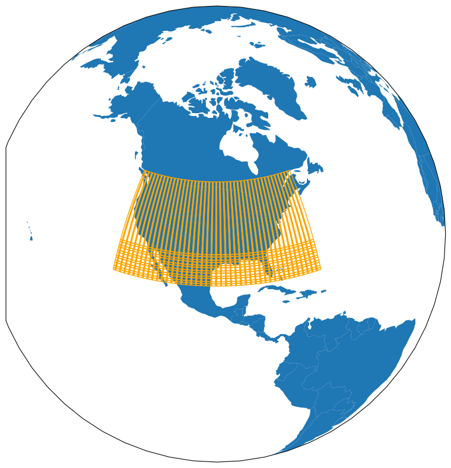
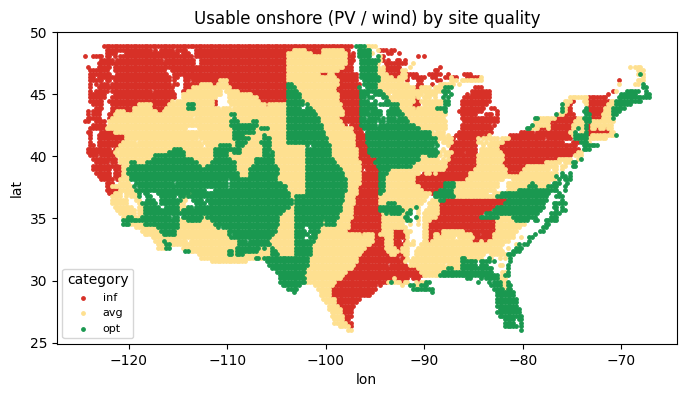
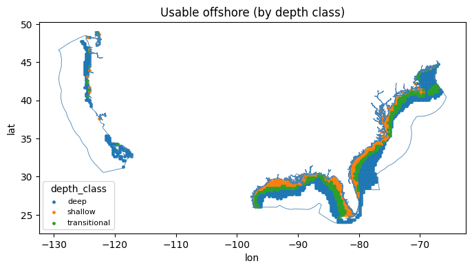
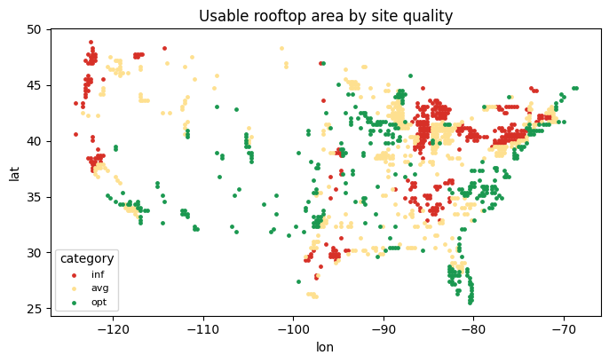
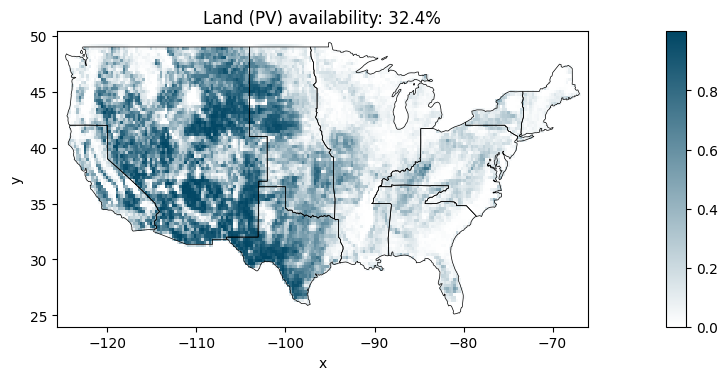
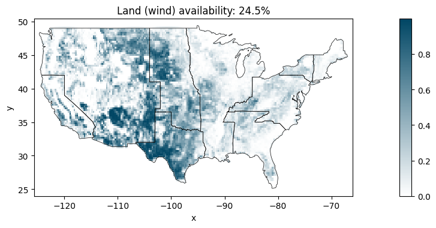
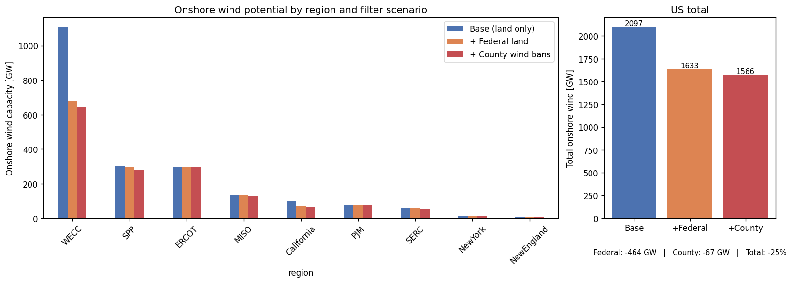

# GIS & Timeseries Tool

Generates renewable **capacity-factor timeseries** and GIS-based **renewable energy potentials** for [GENeSYS-MOD](https://github.com/GENeSYS-MOD), built on [atlite](https://atlite.readthedocs.io) and the ERA5 reanalysis dataset.

**Timeseries** (hourly, per region):

- Utility-scale PV (fixed or per-cell optimal tilt) and rooftop PV
- Onshore and offshore wind (configurable turbine models)
- Temperature, heat-pump COP (air & ground source), heating/cooling degree proxies

**GIS potentials** (installable capacity per region, from land-cover / protected-area / bathymetry exclusion analysis):

- Utility PV and onshore wind on available land
- Rooftop PV on built-up areas
- Offshore wind per water-depth class (shallow / transitional → fixed foundations, deep → floating)

The tool is **region-agnostic**: all logic lives in [functions.py](functions.py), and the notebooks are thin drivers that pass region-specific data (polygons, land-cover rasters, class codes, capacity densities) as parameters. The same code runs Germany, Europe, the US, or any region you provide data for.

  

## Example outputs

Usable onshore sites (PV / onshore wind) for the lower-48 US, categorised by site quality (`opt` / `avg` / `inf` — best / average / worst third of long-run yield):

Usable offshore wind sites in the US EEZ, classified by water depth (shallow / transitional / deep):

Usable rooftop-PV sites (built-up land-cover classes only):

Stitched land-availability maps from the exclusion analysis (share of each cell developable). Utility PV and onshore wind differ because wind gets additional exclusion layers (e.g. federal land, county wind ordinances):

Effect of stacking exclusion filters on the onshore wind potential (US example: base land exclusion → + federal land → + county wind ordinances):

## Folder layout

| Path | Contents |
|---|---|
| [functions.py](functions.py) | All logic. Edit here, not in the notebooks. |
| [GENeSYS-MOD_RES_Tool.ipynb](GENeSYS-MOD_RES_Tool.ipynb) | Reference notebook (small Germany example run). Start here. |
| `GENeSYS-MOD_RES_Tool_DE.ipynb` / `_CA.ipynb` / `_US.ipynb` | Full regional setups (Germany, Canada, US). Depend on large local `geodata/` layers that are **not** in git. |
| `geodata/` | Input layers, by kind: `config/` (small tables, e.g. rooftop shares), `regions/` (region polygons), `example/` (Germany example set), `landcover/`, `exclusions/` (protected areas, ordinances), `offshore/` (EEZ, bathymetry), `_cache/` (raw downloads). Only `config/`, `regions/` and `example/` are in git. |
| [sources/data_sources.csv](sources/data_sources.csv) | Provenance of every externally sourced dataset: provider, version, URL, licence, local path, build script. |
| `cutouts/` | ERA5 cutouts (`.nc`) + `era5_cache/` (raw CDS download cache). Git-ignored. |
| `solarpanel/` | PV panel configs (e.g. `CSi.yaml`, `CdTe_inv95.yaml`). |
| `windturbines/` | Turbine power-curve configs (Vestas, Siemens Gamesa, NREL reference turbines, …). |
| `output/` | Generated results: timeseries per weather year, plus `potentials/`, `coords/` and `zip_transfer/`. Git-ignored. See [Outputs](#outputs). |
| `migrate_output_layout.py` | Moves an `output/` folder from the old flat layout to the current one. |

## Requirements

Python ≥ 3.9 with: `atlite`, `xarray`, `dask`, `geopandas`, `pandas`, `numpy`, `matplotlib`, `seaborn`, `cartopy`, `scikit-learn`, `rasterio`, `shapely`, `pyyaml`.

ERA5 data is downloaded through the Copernicus **Climate Data Store**: register at [cds.climate.copernicus.eu](https://cds.climate.copernicus.eu/) and configure your API key as described in the [CDS API docs](https://cds.climate.copernicus.eu/api-how-to).

Mind the memory: continental extents need substantial RAM (≥ 24 GB for Europe-scale cutouts). The GIS analysis has a memory-safe per-region mode for large extents (see below).

## Quickstart

Open a notebook (start with [GENeSYS-MOD_RES_Tool.ipynb](GENeSYS-MOD_RES_Tool.ipynb)) and work through it top to bottom. The flow is:

1. **Configure** — turbine/panel models, region file, offshore EEZ + bathymetry files, `timeframe`, cutout `filename`, grid resolution (`dx_step`/`dy_step`), and the run switches:
   - `generate_full_area_timeseries` — full-area capacity-factor export (slow; leave off while iterating on GIS potentials)
   - `run_GIS_analysis` — master switch for the availability analysis; when off, usable sites are loaded from a previous run (`output/coords/`)
   - `run_GIS_analysis_by_region` — memory-safe per-region loop vs. single-pass
2. **`estimate_cutout_size(...)`** — prints grid cells, time steps and data volume *before* anything is downloaded. Adjust extent/resolution if too large. `plot_offshore_bathymetry(...)` maps water depth, the EEZ, the cutout extent and the cells that will count as offshore sites, also before downloading.
3. **`get_cutout(...)`** — downloads and prepares the ERA5 cutout. Downloads are chunk-cached in `cutouts/era5_cache/`, so an interrupted run resumes instead of re-downloading; corrupt cutouts are detected and rebuilt.
4. **`get_coords(...)`** — builds onshore/offshore coordinate sets. Offshore cells are clipped to the EEZ and classified by depth from the bathymetry grid. Where offshore wind is only planned in designated zones, `offshore_zone_coords(...)` replaces the EEZ cells with the cells those zones overlap, weighted by the zone share of each cell (the India notebook does this for the MNRE/NIWE zones off Gujarat and Tamil Nadu).
5. **Timeseries** — `pv_capacity_factors`, `wind_onshore_capacity_factors`, `wind_offshore_capacity_factors`, `temperature_timeseries` (also yields heat-pump COP and heating/cooling series).
   Offshore cells belong to the country whose EEZ they lie in, when the EEZ file has a `region` column (the Europe and APAC hub files do). In a tiled run, `run_batch_by_tile(..., offshore_cross_tile=True)` (on in the Europe notebook) also gives a country the cells of its EEZ and zones that lie outside its own tile's cutout box, each once, with the weather of the tile whose cutout holds them; without it that sea is lost (Norway's west, the Black Sea south of the east tile). Two gaps remain and are counted in the run-info sidecar: such a cell outside every bathymetry grid has no depth and is dropped, and sea that no tile cutout holds (e.g. part of the Dogger Bank between the british_isles, france_bnl and nordics boxes) cannot be added.
6. **GIS potentials** — build exclusion containers (`make_land_excluder`, `make_rooftop_excluder`, optional extra layers via `add_exclusion_layers`), then `calculate_potentials_per_region(...)` for the memory-safe all-region run. Offshore via `calculate_offshore_potentials(...)`. Utility PV gets its own excluder (land rules + a 500 m setback around built-up land, + forest in Europe) at 79.2 MW/km² ([Risch et al. 2022](https://doi.org/10.3390/en15155536)); onshore wind uses the plain land rules. Offshore wind is sized to official targets: with designated zones (`offshore_zones`) and targets (`load_offshore_targets`, from [geodata/config/offshore_targets.csv](geodata/config/offshore_targets.csv)), `calibrate_offshore_sites` sets each country's potential to its 2050 target, or to max(2 × its latest target, zone capacity) where none exists. It fills the zones first and puts any remainder on the rest of the EEZ. The usable offshore profiles are then weighted by the capacity placed in each cell. Zones exist for Europe (EMODnet), the US (BOEM leases), Australia and India.
7. **Usable-site timeseries** — filter cutout cells to developable sites (`usable_onshore_coords`, `usable_offshore_coords`) and rerun the capacity-factor functions on those, giving "usable sites only" timeseries per site-quality category.

## Two region workflows

`get_coords` auto-selects the workflow from the columns of your `geo_file`:

- **Region-geojson** (recommended): the geojson has a `region` column; results are produced per region polygon. Offshore areas come from an EEZ polygon + bathymetry grid. Used by the US (RTO/ISO regions), Canada and Germany notebooks.
- **Country/ISO**: the geojson has `iso_a2` / `iso_3166_2` columns (natural-earth admin boundaries); `admin=0` gives country level, `admin=1` states/provinces.

## Outputs

Every timeseries is named `<year>_<run>_<series>.csv`, where `<run>` is the notebook's `filename`:

- `output/<year>/` — timeseries:
  - `..._usable_pv_{inf,avg,opt}`, `..._usable_pv_rooftop_{residential,commercial}`, `..._usable_wind_onshore_{inf,avg,opt}`, `..._usable_wind_offshore_{shallow,transitional,deep}` — capacity factors on developable sites only (what the model uses)
  - `..._pv_*`, `..._wind_*` without `usable_` — the same over all cells
  - `..._temperature`, `..._heating`, `..._cooling`, `..._heatpump_cop`, `..._heatpump_ground_cop`
  - `tiles/` — per-tile files of a tiled (EU / APAC) run; the combined files sit one level up
  - PV series are capacity factors capped at 1 (see below); wind series are not capped
- `output/potentials/` — `<run>_potentials_combined.csv` (installable capacity in GW per region and technology on usable areas: PV, wind, rooftop by segment, offshore by depth class), per-region tables, offshore detail; `tiles/` and `scenarios/<name>/` for tiled and US scenario runs. Next to each combined table, `<run>_potentials_run_info.json` records the run: tool commit and `functions.py` hash, the cutout's weather period (it sets the inf/avg/opt split), panel, turbine, the PV cap (`pv_cf_max`), densities, thresholds, excluder layers, the onshore cell rule, and the offshore settings with the zones file, the targets and their file, the headroom and the per-region offshore calibration (rule, target, zone / whole-EEZ capacity, GW sited in zones and on the EEZ). `write_run_info=False` turns it off; `run_info={...}` adds fields
- `output/coords/` — usable-site coordinates per technology (same subfolders)
- `output/zip_transfer/<year>_<run>_genesys_inputs.zip` — written by `create_transfer_zip` (last notebook cell): heat series and heat-pump COPs, usable-site profiles and `potentials_combined`, with a `manifest.json` describing each file. Copy it into the GENeSYS-MOD data repo's input folder.

### PV capacity factors are capped at 1 (`pv_cf_max`)

The panel models (CSi, CdTe_inv95) give a few hourly values slightly above 1 (output per unit of rated capacity): before the cap, Europe 2018 reached 1.087 in the usable `pv_opt` series (TJ), North America 1.028, India 1.036. Every regional PV series is therefore capped as it is written, `value = min(value, 1.0)` (owner decision 2026-11-17): utility PV `pv_{inf,avg,opt}` (usable and full-area), rooftop `pv_rooftop_{residential,commercial}`, the tracking series `pv_{horizontal,tilted_horizontal,vertical,dual}`, in single and tiled runs (also the combined files of `run_batch_by_tile`). The cap acts on the regional series, not on the cells: the per-cell values, the inf/avg/opt split and the `*_raw.csv` files are unchanged. NaN stays NaN and values at or below 1 keep their exact text. The setting is `pv_cf_max` (default `PV_CF_MAX = 1.0`, `None` = uncapped) on `pv_capacity_factors`, `pv_rooftop_capacity_factors`, `pivot_and_categorize`, `calculate_potentials_per_region` (records it in the run-info sidecar) and `run_batch_by_tile`. `create_transfer_zip` always packs PV capped at 1 and records `pv_cf_max` in the manifest; its PV unit text is `capacity factor (0-1; output per unit of rated capacity, hourly values above 1 capped at 1 per region)`.

`cap_pv_series_file(path)` brings a PV series written before the cap to the capped state in place: only fields above 1 become `1.0`, so the file equals what the writers now write, and a file without a value above 1 is not touched. It refuses (ValueError) a file whose name has no `_pv_` or ends in `_raw.csv`, so wind, heat and per-cell files cannot be capped by mistake. `python check_pv_cap.py [series.csv ...]` checks the cap on synthetic data and, on copies, on the given files.

### Maps per region and saved figures

All optional; without them every map is drawn as before and no number changes.

- `calculate_potentials_per_region(..., plot_regions=True, fig_dir="output/figures")` also draws the PV land, wind land and rooftop availability map of **each region** (title `Land (PV) availability, <region>: x%`) and saves every map it draws as PNG: `<kind>.png` (or `<kind>__<fig_scope>.png`) for the stitched maps, `<kind>__<region>.png` per region (`kind` = `land_availability_pv`, `land_availability_wind`, `rooftop_availability`). `maps_out={}` returns the arrays. The same arguments on `run_batch_by_tile` name the stitched tile maps `<kind>__<tile>.png`; its result also holds `region_maps` (for `plot_region_availability` afterwards) and each `maps` entry carries the wind map (`.wind`).
- `combine_and_plot_tile_maps(result["maps"], which="land" | "wind" | "rooftop", save_path=...)` merges the tiles into one array (`mosaic_tile_maps`: a cell covered by two tiles gets the sum of both, as regions are summed within a tile) and shows all tiles.
- `plot_usable_coords(..., regions=["SG"], boundary_file=eez, boundary_query="region == 'SG'", mark_outside_boundary=True, exclusion=..., save_path=...)` frames one region (or `extent=(lon_min, lat_min, lon_max, lat_max)`), outlines that region's waters, marks cells outside them and shades excluded areas.
- `plot_offshore_bathymetry(...)` and `plot_offshore_map(...)` accept the EEZ and region files as GeoDataFrames read once and take `save_path`; `plot_offshore_bathymetry` also takes `offshore_query` (e.g. `"region == 'DE'"`) to shade and count one country's EEZ only. Frame a region with `extent`.
- `plot_offshore_constraints(cells, eez, "SG", owner_labels={"MY": "Malaysia"}, exclusion=..., save_path=...)` colours candidate offshore cells by the owner of the EEZ polygon they lie in (the EEZ file's `region` column, the same one `get_coords` assigns offshore cells by), outlines the region's own waters and states how many cells there remain allowed.
- `save_figure(fig, path)` and `figure_name(kind, scope)` are the helpers behind these.

### Onshore cells of small regions (`onshore_cell_rule`)

By default (`onshore_cell_rule="centre"`) a cutout cell counts onshore for the region whose polygon contains the cell centre. On a coarse grid a small region loses most of its land that way: Singapore at 0.1 deg has 16 cells with eligible land, wind or roof area, but only 6 centres inside its polygon. `calculate_potentials_per_region(..., onshore_cell_rule="intersect")` (also on `run_batch_by_tile`) counts every cell whose eligible area inside the region polygon is above zero, for PV, onshore wind and rooftop, and counts only the part inside the polygon (the availability matrix of one region holds just that part), so a cell on a border is split between the neighbours, never counted twice. The usable coords, and so the usable series, use the same cells; `Area [km²]` is then the area of those cells inside the polygon. Heat and full-area series are built from `coords_onshore` and keep the centre rule; offshore cells and the offshore calibration are not affected. The Singapore and APAC notebooks switch it on (owner decision 2026-11-13); every other notebook keeps the default.

The APAC hub file `geodata/regions/fel_APAC_regions.geojson` is land only (`build_apac_regions.py`; Singapore's land from the EEZ v12 coastline, see `geodata/regions/README_fel_APAC_regions.md`). The original with a 0.5 deg sea buffer, made for powerplantmatching, is kept as `fel_APAC_regions_buffered.geojson`; with it the buffer counted the first ~55 km of sea as onshore, and Singapore's onshore set covered every sea cell around it, so it had no offshore cells of its own.

## Data not in git

ERA5 cutouts (`cutouts/`) and the large input layers (`geodata/landcover/`, `geodata/exclusions/`, `geodata/offshore/`) are kept on the project SharePoint rather than in git, to keep the repository small. Copy them into the same folders locally. [sources/data_sources.csv](sources/data_sources.csv) lists every layer with its local path and original source; the `build_*.py` scripts rebuild most of them from public data.

## Adding a new region

1. Create a region geojson with a `region` column (or use country ISO codes).
2. Collect the data layers: a land-cover raster (note its class codes and CRS), protected-area files, and — for offshore — an EEZ polygon and a bathymetry grid.
3. Copy an existing notebook and swap paths, class-code lists and capacity densities. No `functions.py` change should be needed.
4. Run `estimate_cutout_size` first, and test the GIS part on a single region (`get_region_shapes(geo_file, ['<one region>'])`) before a full run.

## Performance & platform notes

- **Memory-safe GIS mode**: `calculate_potentials_per_region` processes one region at a time, so high-resolution land-cover rasters (e.g. 30 m NLCD) are only rasterized over one region's bounding box at once. Use it for anything continental; the single-pass variant can exhaust RAM.
- **Resumable downloads**: `get_cutout` caches every CDS request chunk in `cutouts/era5_cache/` keyed by request hash — interrupted or failed runs reuse cached chunks.
- **Windows + antivirus**: large cutout writes can appear to freeze at "99% Completed" while the real-time virus scan locks the multi-GB `.nc` file. Exclude the `cutouts/` folder from scanning (admin PowerShell): `Add-MpPreference -ExclusionPath "<path-to>\GIS_&_Timeseries_Tool\cutouts"`.
- **Big runs are slow**: large protected-area files and 30 m rasters take time. Iterate on one region and a short timeframe first.

## License

Apache License 2.0 — see [LICENSE.txt](../LICENSE.txt).
